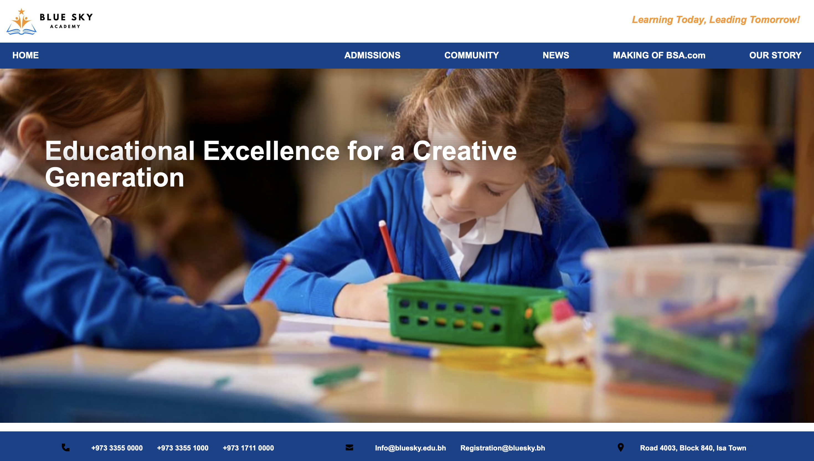
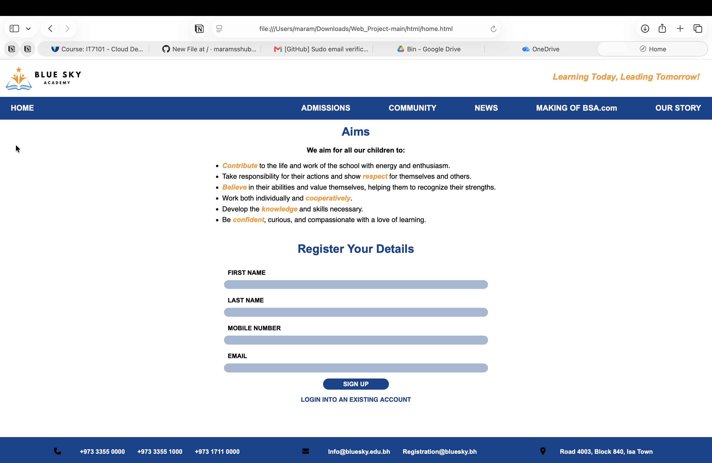
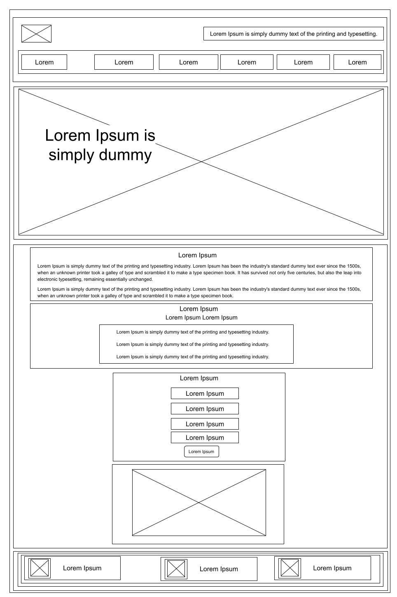
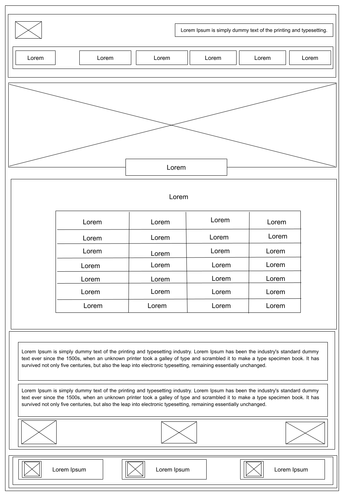
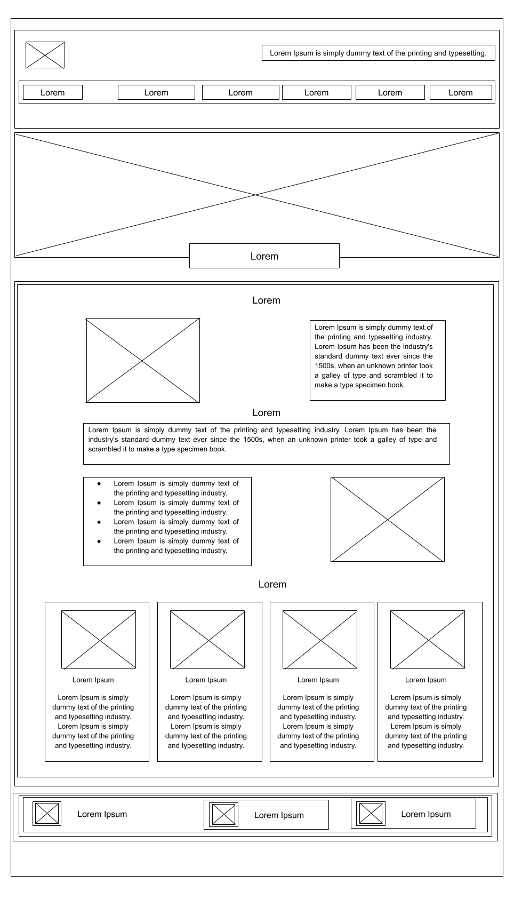
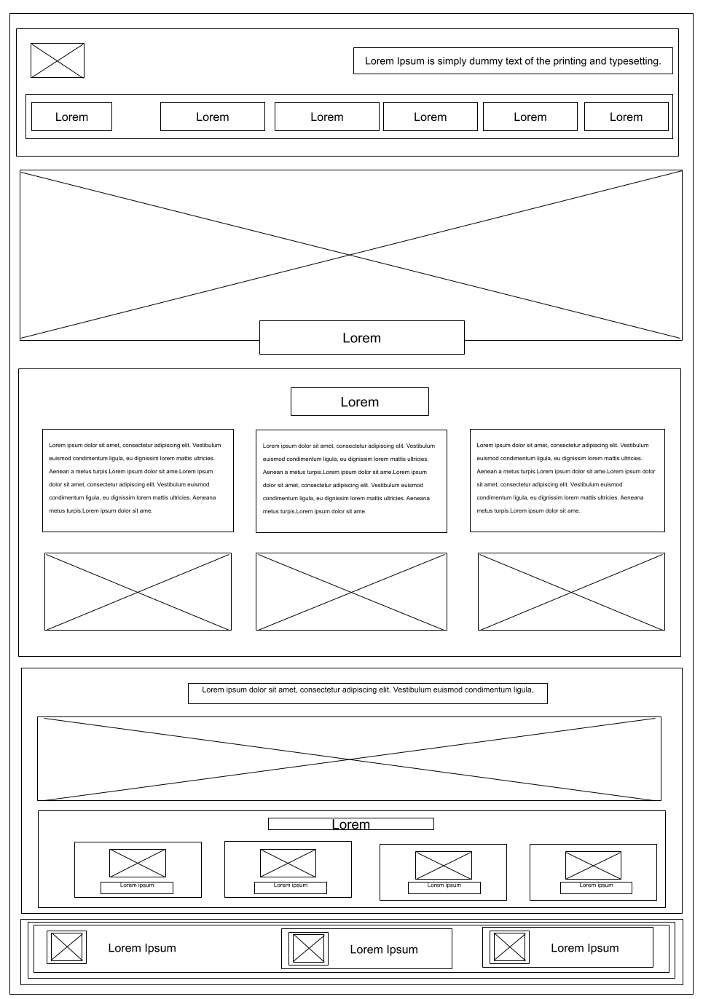
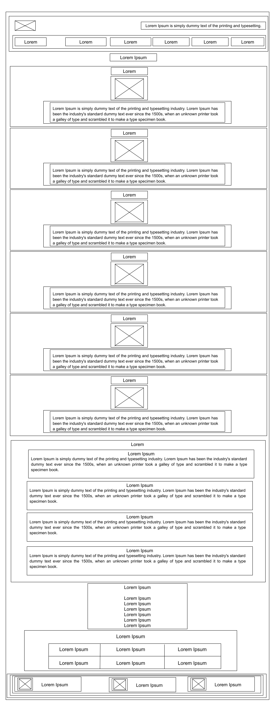
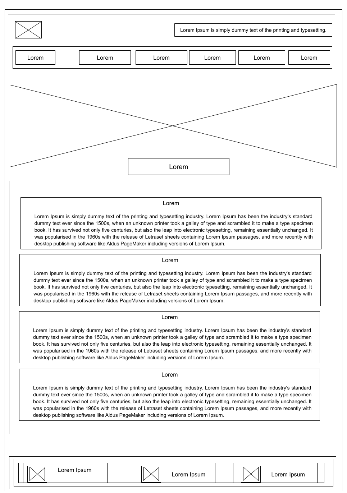

<h1 align="center">Blue Sky Academy Website</h1>

A web development coursework project built with HTML, CSS, and JavaScript.

## About the Project

Blue Sky Academy is a school website designed to help prospective families learn about the school, explore admissions, and follow school news and community activities. The site includes six pages: **Home**, **Admissions**, **Community**, **News**, **Our Story**, and **Making Of BSA.com**.

## Website Preview

### Homepage

### Registration Form

## Making Of BSA.com

The Making Of page documents the design process, including early page layouts, navigation choices, and the blue and orange color palette.

### Low-Fidelity Wireframes

| Home | Admissions | Community |
| --- | --- | --- |
|  |  |  |

| News | Making Of | Our Story |
| --- | --- | --- |
|  |  |  |

## Run Locally

1. Download or clone the repository.
2. Open `Web_Project-main/html/home.html` in your browser.
3. Use the navigation menu to explore the site and open **Making Of BSA.com**.

Keep the project folders together so the styles, scripts, and images load correctly. No installation or build step is required.
